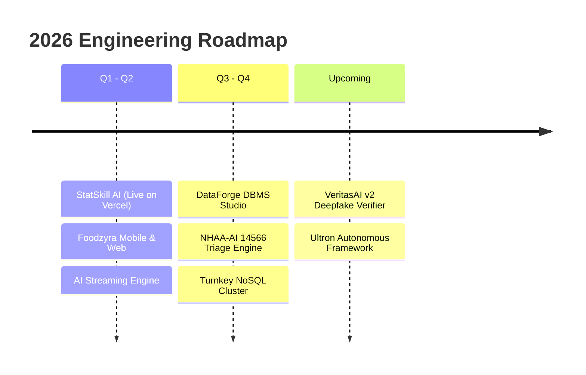

# Hi there, I'm C. Dharshan 👋

  
  
  

---

### 🚀 About Me

- 🎓 **B.Tech in Artificial Intelligence & Data Science** at **Coimbatore Institute of Engineering and Technology (CIET)**.
- ⚡ **Core Competencies**: High-throughput asynchronous architectures (`FastAPI`, `asyncio`), LLM token streaming (SSE), Item Response Theory (2PL IRT) psychometrics, sub-$5\text{ms}$ exact-match caching, pure **Object-Oriented Programming (Java 17+, Swing GUI)**, and responsive cross-platform web/mobile applications (`React 19`, `Capacitor`, `Tailwind CSS`).
- 🛠️ **Engineering Philosophy**: Architecture first, sub-millisecond latency, strictly typed contracts (`Pydantic v2`, `TypeScript`), resilient custom checked exceptions, and offline-first data replication (CRDTs).
- 🎯 **Recent Milestones**:
  - Architected & deployed **StatSkill AI** for India's Official Statistical System (**MoSPI / NSSTA & Mission Karmayogi**, SIH PS 21121).
  - Built **Foodzyra**, an AI-powered real-time surplus food rescue & redistribution platform with native Android support.
  - Engineered the **AI Production Streaming Engine** with SSE, SHA-256 caching, and sliding-window rate limiting.

---

### 🛠️ Tech Stack & Skills Matrix

| Domain | Technologies & Frameworks |
| :--- | :--- |
| **Languages** |        |
| **Backend & Distributed Systems** |       |
| **AI / ML & Multimodal LLMs** |       |
| **Databases & Caching** |       |
| **Frontend & Mobile** |      |
| **DevOps & Infrastructure** |     |

---

## 🏆 Production Projects (Live & Open-Source)

<table>
  <!-- ROW 1 -->
  <tr>
    <td width="50%" valign="top">
      <h3 align="center"><a href="https://github.com/iamwarriorofmyuniverse-coder/statskill-ai">📊 StatSkill AI Platform</a></h3>
      

        
        
        
        
      

      <b>Next-Gen Statistical Cadre Competency & Psychometric Calibration Platform (SIH PS: 21121)</b>
      <ul>
        <li><b>2PL Item Response Theory Engine</b>: Dynamically models officer latent ability ($\theta \in [-3, +3]$) using Fisher Information maximization, cutting test fatigue by 42% ($SEM < 0.21$).</li>
        <li><b>Microdata Flight Simulator</b>: Interactive Monte Carlo sandbox evaluating sampling strategies (SRS vs. Neyman Stratified) and non-sampling error imputation (Hot-Deck, MICE).</li>
        <li><b>AI Viva-Voce Board</b>: Browser-based speech recognition and Gemini-powered oral evaluation.</li>
        <li><b>Offline-First CRDT</b>: Conflict-free replicated data types with Lamport clocks for disconnected rural field operations.</li>
      </ul>
    </td>
    <td width="50%" valign="top">
      <h3 align="center"><a href="https://github.com/iamwarriorofmyuniverse-coder/foodzyra">🍲 Foodzyra (Surplus Food Rescue)</a></h3>
      

        
        
        
        
      

      <b>AI-Powered Real-Time Surplus Food Redistribution Platform</b>
      <ul>
        <li><b>Multi-Stakeholder Architecture</b>: Connects restaurants, bakeries, and grocers with conscious consumers and verified hunger-relief NGOs.</li>
        <li><b>AI Food Vision</b>: Gemini multimodal model estimates freshness, remaining shelf-life hours, and macronutrient breakdowns from uploaded photos.</li>
        <li><b>Frictionless QR Pickups</b>: Cryptographic QR generation and in-browser scanner for contactless donation handoffs.</li>
        <li><b>Hybrid Mobile Ready</b>: Full Capacitor Android integration with native hardware access.</li>
      </ul>
    </td>
  </tr>

  <!-- ROW 2 -->
  <tr>
    <td width="50%" valign="top">
      <h3 align="center"><a href="https://github.com/iamwarriorofmyuniverse-coder/ai-production-streaming-engine">⚡ AI Production Streaming Engine</a></h3>
      

        
        
        
        
      

      <b>High-Throughput Asynchronous LLM Token Streaming Service</b>
      <ul>
        <li><b>Server-Sent Events (SSE)</b>: Low-latency chunked token streaming with client disconnect cancellation protection.</li>
        <li><b>Sub-5ms SHA-256 Cache</b>: In-memory exact-match response cache serving repeat queries in under 5 milliseconds.</li>
        <li><b>Sliding-Window IP Rate Limiting</b>: Protects upstream inference providers from burst traffic and resource starvation.</li>
        <li><b>Cloud Native</b>: Multi-stage Docker container with complete health endpoints and Swagger OpenAPI documentation.</li>
      </ul>
    </td>
    <td width="50%" valign="top">
      <h3 align="center"><a href="https://github.com/iamwarriorofmyuniverse-coder/hostel-room-allotment-system">🏨 Hostel Room Allotment System</a></h3>
      

        
        
        
        
      

      <b>Enterprise Dual-Engine Campus Accommodation Platform</b>
      <ul>
        <li><b>Dual Engine Architecture</b>: Interactive Java Swing desktop application and modern web UI sharing clean domain models.</li>
        <li><b>Pure OOP Engineering</b>: Polymorphic room hierarchies (Standard, Deluxe, AC Suites), encapsulation, and custom checked domain exceptions.</li>
        <li><b>Telemetry & Digital Passes</b>: Instant occupancy calculation, floor-by-floor filtering, and printable digital allotment passes.</li>
      </ul>
    </td>
  </tr>

  <!-- ROW 3 -->
  <tr>
    <td width="50%" valign="top">
      <h3 align="center"><a href="https://github.com/iamwarriorofmyuniverse-coder/veritas-ai">🔍 VeritasAI Fact-Checking Engine</a></h3>
      

        
        
        
      

      <b>Real-Time Claim Verification & Stance Detection Pipeline</b>
      <ul>
        <li><b>Live News Grounding</b>: Queries real-time Google News Wire RSS feeds to retrieve verified journalistic evidence.</li>
        <li><b>Manifest V3 Extension</b>: 1-click contextual browser extension for instant verification of social media claims and article snippets.</li>
        <li><b>Credibility Dial</b>: Multi-stance semantic verification outputting explainable credibility confidence scores.</li>
      </ul>
    </td>
    <td width="50%" valign="top">
      <h3 align="center"><a href="https://github.com/iamwarriorofmyuniverse-coder/my-streamlit-app">🎈 Applied ML & Analytics Suite</a></h3>
      

        
        
        
      

      <b>Interactive Machine Learning & Data Science Applications</b>
      <ul>
        <li><b>18 Interactive Apps (mk1–mk18)</b>: Covers regression, classification, stateful games, dynamic enquiry portals, and sales analytics.</li>
        <li><b>Smart Crop Recommendation Classifier</b>: Multi-parameter agricultural model predicting optimal crop types using soil chemistry and climate metrics.</li>
        <li><b>Student Exam Marks Predictor</b>: Regression pipeline with exploratory data analysis Jupyter notebooks.</li>
      </ul>
    </td>
  </tr>

  <!-- ROW 4 -->
  <tr>
    <td width="50%" valign="top">
      <h3 align="center"><a href="https://github.com/iamwarriorofmyuniverse-coder/autoshare-ledger">💰 AutoShare Ledger</a></h3>
      

        
        
        
      

      <b>Vehicle Rental Ledger & Optimal Peer Debt Settlement</b>
      <ul>
        <li>Automated expense split engine utilizing directed graph flow reduction algorithms.</li>
        <li>Minimizes total cash-settlement transactions across arbitrary party networks.</li>
        <li>Persistent SQLite transactional schema ensuring zero double-entry errors.</li>
      </ul>
    </td>
    <td width="50%" valign="top">
      <h3 align="center"><a href="https://github.com/iamwarriorofmyuniverse-coder/ciet-tree-stocking">🌳 CIET Tree Stocking Platform</a></h3>
      

        
        
        
      

      <b>Campus Ecological Census & Geo-Spatial Inventory</b>
      <ul>
        <li>Digital mapping and inventory tracking for institutional green assets and biodiversity.</li>
        <li>Species classification, survivability indexes, and carbon sequestration estimations.</li>
        <li>Interactive dashboard for maintenance scheduling and canopy density reports.</li>
      </ul>
    </td>
  </tr>

  <!-- ROW 5 -->
  <tr>
    <td width="50%" valign="top">
      <h3 align="center"><a href="https://github.com/iamwarriorofmyuniverse-coder/focusjail-backend">🔒 FocusJail Backend</a></h3>
      

        
        
        
      

      <b>Distraction Blocker & Cryptographic Focus Session Engine</b>
      <ul>
        <li>Strict session-locking algorithms enforcing uninterrupted deep-work sprints.</li>
        <li>Activity telemetry tracking, streak mechanics, and penalty deduction rules.</li>
      </ul>
    </td>
    <td width="50%" valign="top">
      <h3 align="center"><a href="https://github.com/iamwarriorofmyuniverse-coder/csv-cleaner">🧹 CSV Cleaner Pro</a></h3>
      

        
        
        
      

      <b>High-Performance In-Browser Tabular Data Hygiene Utility</b>
      <ul>
        <li>Automated detection and repair of malformed rows, irregular delimiters, and encoding artifacts.</li>
        <li>Deduplication, missing-value imputation, and export to standardized schema formats.</li>
      </ul>
    </td>
  </tr>

  <!-- ROW 6 -->
  <tr>
    <td width="50%" valign="top">
      <h3 align="center"><a href="https://github.com/iamwarriorofmyuniverse-coder/LibraryBookSearch">📚 Java Winchester & Library Suite</a></h3>
      

        
        
      

      <b>Java OOP Desktop Suite & Computational Geometry Checker</b>
      <ul>
        <li><b>Library Book Search GUI</b>: Interactive Java Swing inventory search with case-insensitive filtering and dynamic status banners.</li>
        <li><b>Land Plot Layout Checker</b>: OOP model evaluating concentric centering of $n$-sided polygonal land plots.</li>
      </ul>
    </td>
    <td width="50%" valign="top">
      <h3 align="center"><a href="https://github.com/iamwarriorofmyuniverse-coder/ultron">🤖 Ultron Core</a></h3>
      

        
        
      

      <b>Autonomous Agentic Architecture Repository</b>
      <ul>
        <li>Repository holding architectural foundations and future collaborative agent runtimes.</li>
      </ul>
    </td>
  </tr>
</table>

---

## 🔮 Upcoming & In-Development Projects

### 1. 🗄️ DataForge DBMS Studio
> **Modern Python & CustomTkinter Multi-Database Engineering Studio**
- **Visual ER Diagram Generator**: Automatically reverse-engineers database schemas into interactive entity-relationship diagrams.
- **Visual SQL Studio & Explain Plan**: Syntax-highlighted SQL editor with query execution plan visualizer, sub-millisecond query benchmarking, and CSV/JSON export.
- **Dynamic Schema Designer**: Form-based column creation, constraint configuration (PK, FK, Unique, Check), and live migration script generator.
- **Pre-Seeded Real-World Schemas**: Built-in test environments for E-Commerce, Hospital Management, and University Registrars.

### 2. 🛡️ NHAA-AI 14566: Real-Time Distress & Vulnerability Triage
> **Multimodal AI Intake & Stress Vulnerability Index (SVI) Engine**
- **Trilingual Speech & Text Analysis**: Seamlessly triages incoming distress grievances across **English, Hindi, and Tamil**.
- **Transparent SVI Scoring Matrix (0–100)**: Deconstructs situational risk across text distress (20%), fear (15%), threats (20%), urgency (15%), acoustic tension (10%), and emotion valence (10%).
- **Explainable Human-in-the-Loop Pipeline**: Grounded evidence extraction routing high/critical cases directly to duty officers with full audit trail logging.

### 3. 🌐 Turnkey Multi-Model NoSQL Distributed Stack
> **Turnkey Containerized Cluster: MongoDB + Apache Cassandra + Neo4j**
- Comprehensive Docker Compose orchestration provisioning a Document Store (**MongoDB**), Wide-Column Distributed Store (**Apache Cassandra**), and Graph Database (**Neo4j**).
- Integrated management dashboards (**Mongo Express**, **Neo4j Browser**) with automated health probe scripts and Python/Node ingestion clients.

### 4. 🧠 VeritasAI v2: Multimodal Deepfake & Audio-Visual Verifier
- Extending VeritasAI into multimodal video and synthetic speech verification.
- Integrating frame-level facial artifact detection and voice-clone spectrogram analysis to combat synthetic election misinformation.

---

### 📈 GitHub Telemetry & Stats

  

---

  "Constantly learning, engineering for scale, and building with purpose." 
  Designed & built with 💙 by <b>C. Dharshan</b>

